

  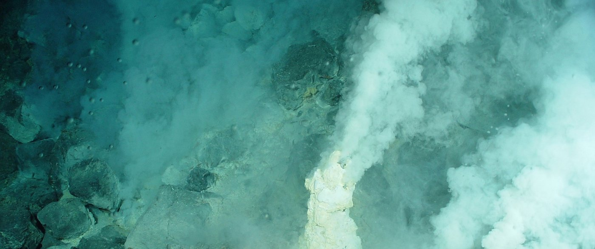

<h1 align="center">🌑 Vida sin luz: lo que vive a 10 km bajo el mar sin un solo rayo de sol</h1>
<h3 align="center">Life without light: what lives 10 km under the sea without a single ray of sunlight</h3>

  <b>Gusanos sin boca, peces transparentes y microbios que comen roca. Y un spoiler: el Sol sigue detrás.</b> 
  <i>Mouthless worms, see-through fish and rock-eating microbes. And a spoiler: the Sun is still behind it all.</i>

  <a href="#es"><b>🇪🇸 Leer en español</b></a> &nbsp;·&nbsp; <a href="#en"><b>🇬🇧 Read in English</b></a>

  <a href="vida-sin-luz-fosas-marinas.pdf">📄 Informe completo (PDF, español)</a> &nbsp;·&nbsp;
  <a href="life-without-light-ocean-trenches.pdf">📄 Full report (PDF, English)</a>

---

# 🇪🇸 Español

> *Imagen superior: chimeneas del sitio Champagne (arco de las Marianas). NOAA, dominio público.*

## Índice

1. [El informe en 30 segundos](#es-resumen)
2. [8 datos que no te esperas](#es-datos)
3. [Cómo funciona: energía sin luz](#es-como)
4. [Las comunidades de 9.533 m](#es-comunidades)
5. [Qué contiene el informe](#es-contenido)
6. [Descargar](#es-descargar)
7. [¿Me puedo fiar? Cómo se hizo](#es-fiabilidad)
8. [Licencias y créditos](#es-licencias)

## 1. El informe en 30 segundos

En 2025 un sumergible tripulado bajó a las fosas de Kuriles-Kamchatka y de las Aleutianas, en el Pacífico norte, y encontró **praderas de gusanos y bancos de almejas hasta 9.533 metros** de profundidad, repartidos a lo largo de 2.500 km. Ahí abajo no llega ni un fotón de luz solar. Viven de **química**: metano y sulfuro de hidrógeno que brotan del fondo y que unas bacterias convierten en alimento.

Este informe explica, para cualquier lector, cómo funciona ese mundo, qué papel juega el **CO₂** en él, qué especies se conocen y qué sigue sin saberse. Es una síntesis de literatura científica publicada: cada dato lleva un nivel de confianza y se indica si se ha comprobado contra una fuente.

## 2. 8 datos que no te esperas

| # | Dato |
|---|---|
| 1 | Hay **comunidades animales a 9.533 m** que no comen nada que caiga de arriba: viven de energía química (*Nature*, 2025). |
| 2 | Los gusanos tubícolas **no tienen boca ni intestino**. Les alimentan las bacterias que llevan dentro. |
| 3 | El fondo de las fosas tiene **entre 2 y 8 veces más actividad** que las llanuras que las rodean: funcionan como un embudo. |
| 4 | En la fosa de las Marianas se encontraron **7.564 especies de microbios; el 89,4 % eran desconocidas**. |
| 5 | Los peces tienen un **límite bioquímico hacia los 8.200–8.400 m** y nunca se ha visto ninguno más abajo. El más profundo filmado estaba a 8.336 m, justo en el límite. |
| 6 | Un pequeño crustáceo que vive hasta casi 11 km de profundidad **digiere madera** con una enzima propia. |
| 7 | En el fondo ya hay **PCB, mercurio, plástico y carbono de las bombas atómicas** de los años 60. |
| 8 | El famoso **"oxígeno oscuro"** de los nódulos metálicos **no está confirmado**: el artículo original lleva una nota editorial desde abril de 2026. |

## 3. Cómo funciona: energía sin luz

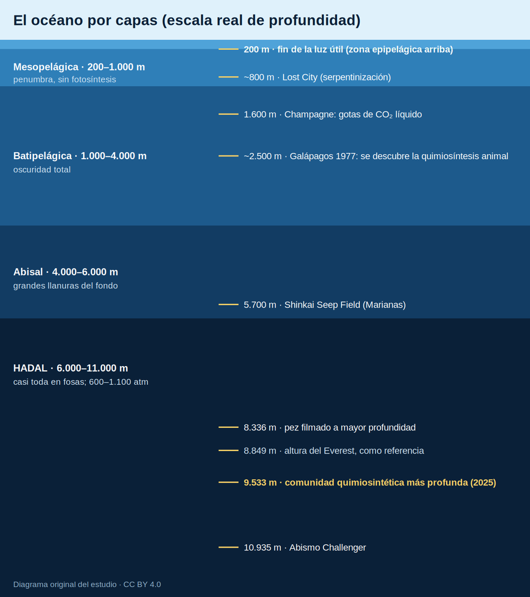

A partir de unos 200 m no queda luz útil, y a partir de 1.000 m la oscuridad es total. Las fosas empiezan a los 6.000 m. Allí la vida tiene dos fuentes de alimento: lo poco que cae desde la superficie y lo que fabrican ciertos microbios con **energía química** en lugar de luz. Eso es la **quimiosíntesis**.

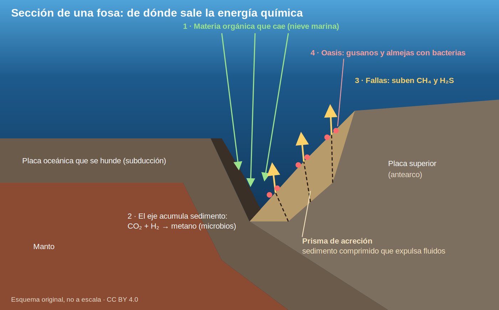

La materia orgánica cae al fondo de la fosa, queda enterrada y los microbios la convierten en **metano**. El metano sube por las fallas, otras bacterias lo transforman en **sulfuro**, y los gusanos y almejas viven del sulfuro gracias a sus bacterias internas.

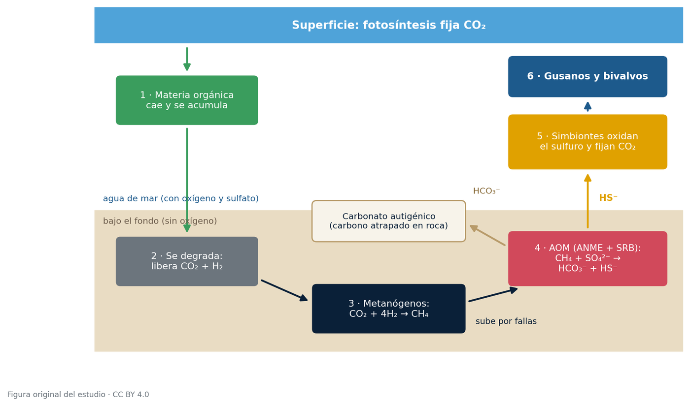

**El CO₂ aparece en cada paso**: se libera al pudrirse la materia orgánica, se convierte en metano y vuelve a fijarse como alimento.

> **El giro final.** "Sin luz" no significa "sin Sol". El oxígeno que usan muchas de estas bacterias y la materia orgánica de la que sale el metano proceden de la fotosíntesis. Solo los sistemas alimentados por hidrógeno de las rocas, como el campo hidrotermal Lost City, son de verdad independientes del Sol.

## 4. Las comunidades de 9.533 m

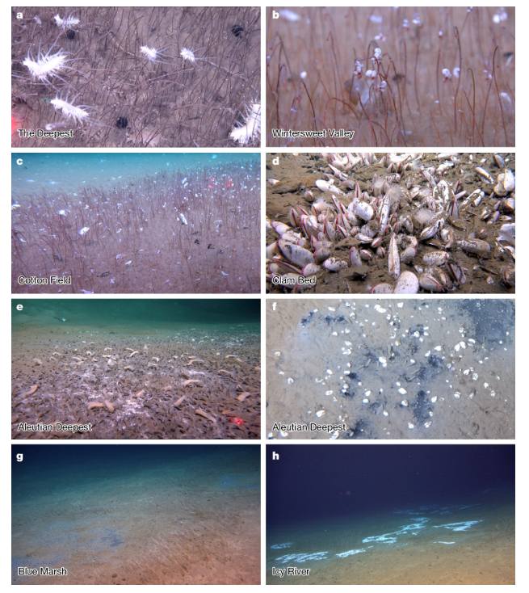

Comunidades quimiosintéticas halladas en 2025: gusanos tubícolas, almejas y tapetes microbianos entre 5.743 y 9.532 m. Peng et al., <i>Nature</i> 645, 679–685 (2025), licencia CC BY-NC-ND 4.0, reproducida sin modificaciones.

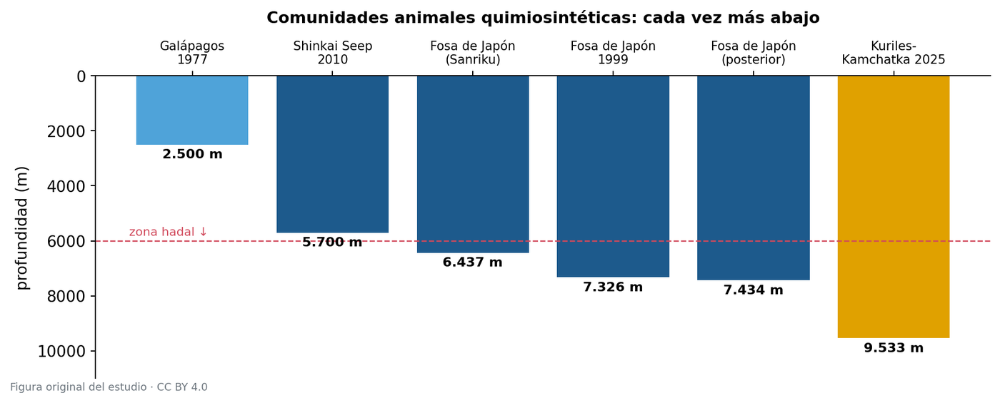

<table>
<tr>
<td width="40%">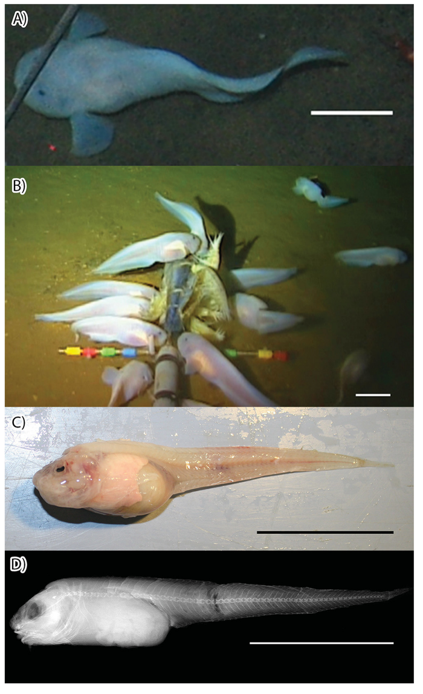</td>
<td>

**El pez caracol de las Marianas** (*Pseudoliparis swirei*)

- Vive entre unos 6.200 y 8.100 m.
- Su piel es **transparente**: se le ven el hígado y el estómago.
- Pone huevos de hasta **9,4 mm**, de los más grandes entre los peces óseos.
- No se ha visto ninguno por debajo de 8.200 m, el límite bioquímico de los peces.

Gerringer et al., <i>Zootaxa</i> 4358, 161–177 (2017), licencia CC BY 3.0.

</td>
</tr>
</table>

## 5. Qué contiene el informe

El PDF tiene **56 páginas**, 23 figuras propias, 3 fotografías y 6 láminas científicas.

| Bloque | Secciones |
|---|---|
| El escenario | El océano por capas · las fosas · de qué se alimenta el fondo |
| La química | Quimiosíntesis · las reacciones una por una · los tipos de oasis · el papel del CO₂ |
| Lo encontrado | El hallazgo de 2025 · catálogo de especies · adaptaciones a la presión · contaminación |
| La fiabilidad | Lo que **no** está demostrado · tabla de verificación · sesgos |
| Para terminar | Glosario de unos 100 términos · 9 preguntas abiertas con lo que responde hoy la ciencia · conclusiones · referencias |

## 6. Descargar

- 📄 [**Informe completo en español** (PDF, 56 páginas)](vida-sin-luz-fosas-marinas.pdf)
- 📄 [Versión en inglés (PDF, 56 páginas)](life-without-light-ocean-trenches.pdf)

## 7. ¿Me puedo fiar? Cómo se hizo

- Es una **síntesis de literatura científica publicada**, no investigación original ni revisada por pares.
- Cada dato lleva un **nivel de confianza** (de 0 a 1) y la marca **[V]** si se comprobó contra una fuente o **[C]** si es conocimiento general.
- Hay una sección entera dedicada a lo que **no** está demostrado.
- Se ha elaborado con **ayuda de inteligencia artificial** (Claude, de Anthropic) y contrastado con fuentes publicadas. Solo un artículo se leyó completo; del resto se consultaron resúmenes, pies de figura y notas de prensa. El informe lo explica en su apartado de limitaciones.

¿Has encontrado un error? Abre un *issue* en este repositorio.

## 8. Licencias y créditos

**Este repositorio no está íntegramente bajo una sola licencia.**

| Material | Licencia |
|---|---|
| Texto y figuras propias | [CC BY 4.0](https://creativecommons.org/licenses/by/4.0/) |
| Fotos de NOAA (portada, gusanos *Riftia*, fumarolas de Champagne) | Dominio público, citando a NOAA |
| Láminas de Peng et al., *Nature* (2025) | [CC BY-NC-ND 4.0](https://creativecommons.org/licenses/by-nc-nd/4.0/): sin uso comercial y sin modificar |
| Láminas de Gerringer et al., *Zootaxa* (2017) | [CC BY 3.0](https://creativecommons.org/licenses/by/3.0/) |

En la práctica, puedes compartirlo libremente **sin fines comerciales** y sin alterar las láminas de *Nature*. El detalle de cada imagen está en la sección 18 del informe.

**Autor:** Óscar Ramírez · Octubre de 2026

<a href="#">⬆️ Volver arriba</a>

---

# 🇬🇧 English

> *Top image: chimneys at the Champagne site (Mariana Arc). NOAA, public domain.*

## Contents

1. [The report in 30 seconds](#en-summary)
2. [8 facts you won't expect](#en-facts)
3. [How it works: energy without light](#en-how)
4. [The communities at 9,533 m](#en-communities)
5. [What's in the report](#en-contents)
6. [Download](#en-download)
7. [Can I trust it? How it was made](#en-reliability)
8. [Licenses and credits](#en-licenses)

## 1. The report in 30 seconds

In 2025 a crewed submersible dived into the Kuril–Kamchatka and Aleutian trenches in the North Pacific and found **fields of tubeworms and beds of clams down to 9,533 meters**, spread along 2,500 km. Not a single photon of sunlight reaches that far. They live on **chemistry**: methane and hydrogen sulfide seeping from the seafloor, which bacteria turn into food.

This report explains, for any reader, how that world works, what role **CO₂** plays in it, which species are known and what is still unknown. It is a synthesis of published scientific literature: every fact carries a confidence level and a note on whether it was checked against a source.

## 2. 8 facts you won't expect

| # | Fact |
|---|---|
| 1 | There are **animal communities at 9,533 m** that eat nothing falling from above: they live on chemical energy (*Nature*, 2025). |
| 2 | The tubeworms **have no mouth and no gut**. They are fed by the bacteria they carry inside. |
| 3 | Trench floors are **2 to 8 times more active** than the plains around them: they work like a funnel. |
| 4 | In the Mariana Trench, **7,564 microbial species were found; 89.4% were unknown**. |
| 5 | Fish have a **biochemical depth limit around 8,200–8,400 m**, and none has ever been seen deeper. The deepest one ever filmed was at 8,336 m, right at the limit. |
| 6 | A small crustacean living almost 11 km down **digests wood** with its own enzyme. |
| 7 | The bottom already holds **PCBs, mercury, plastic and carbon from 1960s atomic bombs**. |
| 8 | The famous **"dark oxygen"** from metallic nodules **has not been confirmed**: the original paper has carried an editor's note since April 2026. |

## 3. How it works: energy without light

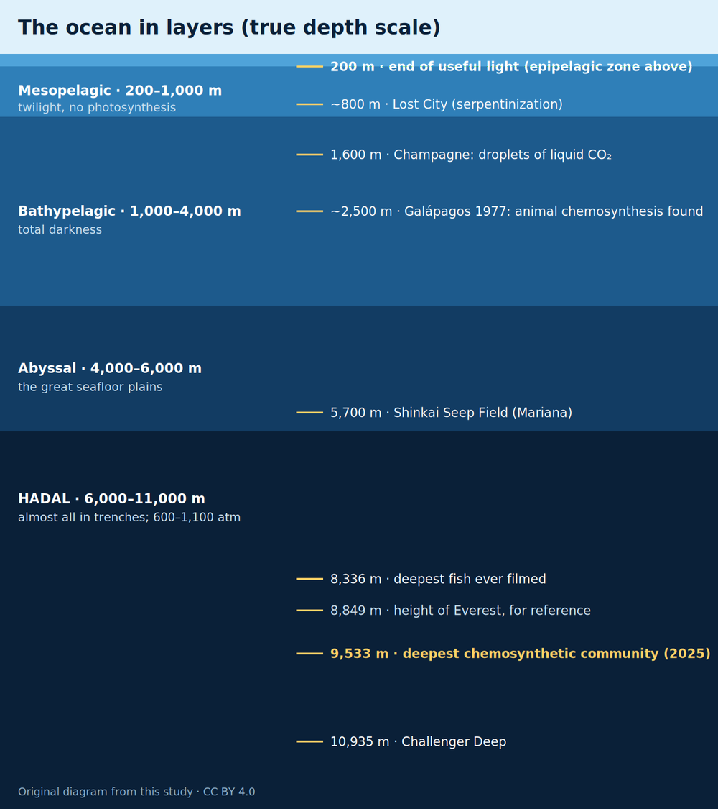

Below about 200 m there is no useful light left, and below 1,000 m it is completely dark. Trenches begin at 6,000 m. Down there, life has two food sources: the little that sinks from the surface, and what certain microbes make using **chemical energy** instead of light. That is **chemosynthesis**.

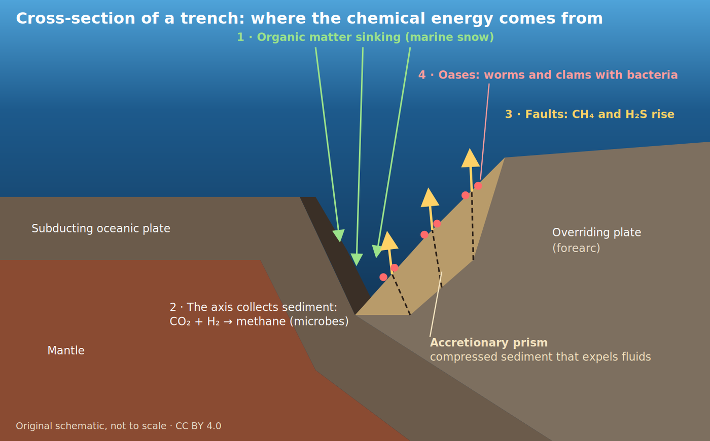

Organic matter falls to the bottom of the trench, is buried, and microbes turn it into **methane**. The methane rises along faults, other bacteria convert it into **sulfide**, and tubeworms and clams live on that sulfide thanks to their internal bacteria.

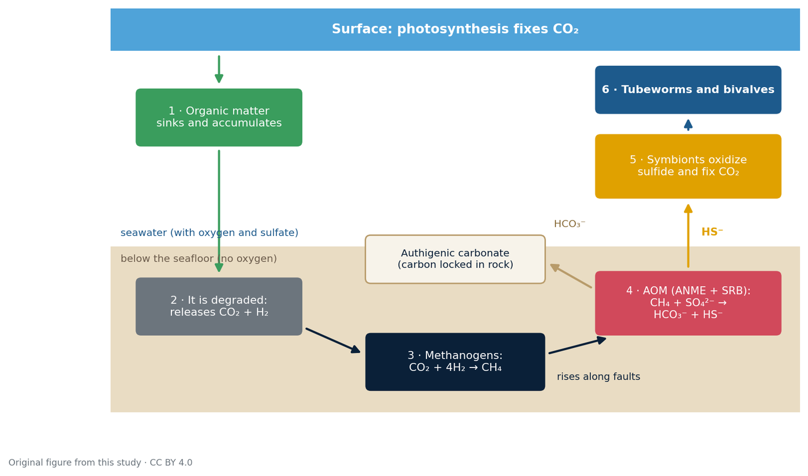

**CO₂ shows up at every step**: it is released as organic matter decays, turned into methane, and fixed again as food.

> **The twist.** "Without light" does not mean "without the Sun". The oxygen many of these bacteria use, and the organic matter the methane comes from, are products of photosynthesis. Only systems fed by hydrogen from rocks, such as the Lost City hydrothermal field, are truly independent of the Sun.

## 4. The communities at 9,533 m

Chemosynthetic communities found in 2025: tubeworms, clams and microbial mats between 5,743 and 9,532 m. Peng et al., <i>Nature</i> 645, 679–685 (2025), license CC BY-NC-ND 4.0, reproduced without modification.

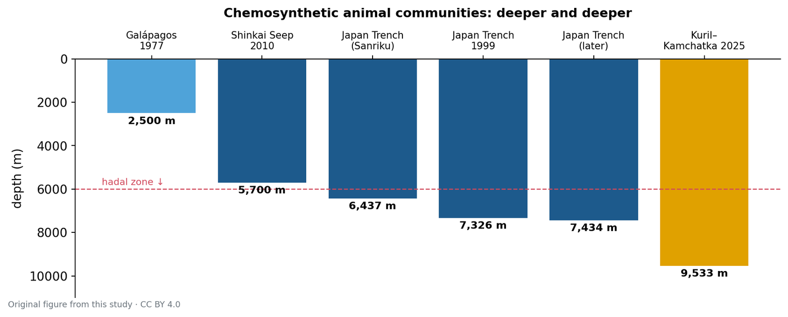

<table>
<tr>
<td width="40%"></td>
<td>

**The Mariana snailfish** (*Pseudoliparis swirei*)

- Lives between about 6,200 and 8,100 m.
- Its skin is **transparent**: you can see its liver and stomach.
- Lays eggs up to **9.4 mm** across, among the largest of any bony fish.
- None has been seen below 8,200 m, the biochemical limit for fish.

Gerringer et al., <i>Zootaxa</i> 4358, 161–177 (2017), license CC BY 3.0.

</td>
</tr>
</table>

## 5. What's in the report

The PDF has **56 pages**, 23 original figures, 3 photographs and 6 scientific plates.

| Part | Sections |
|---|---|
| The setting | The ocean in layers · trenches · what the seafloor feeds on |
| The chemistry | Chemosynthesis · the reactions one by one · kinds of oasis · the role of CO₂ |
| What was found | The 2025 discovery · species catalog · adaptations to pressure · pollution |
| Reliability | What has **not** been demonstrated · verification table · biases |
| To finish | Glossary of about 100 terms · 9 open questions and what science says today · conclusions · references |

## 6. Download

- 📄 [**Full report in English** (PDF, 56 pages)](life-without-light-ocean-trenches.pdf)
- 📄 [Spanish original (PDF, 56 pages)](vida-sin-luz-fosas-marinas.pdf)

## 7. Can I trust it? How it was made

- It is a **synthesis of published scientific literature**, not original research and not peer-reviewed.
- Every fact carries a **confidence level** (0 to 1) and the tag **[V]** if checked against a source or **[C]** if general knowledge.
- A whole section is devoted to what has **not** been demonstrated.
- It was prepared **with the help of artificial intelligence** (Claude, by Anthropic) and checked against published sources. Only one paper was read in full; for the rest, abstracts, figure captions and press releases were consulted. The report explains this in its limitations section.
- The English version is a translation of the Spanish original; in case of discrepancy, the Spanish text prevails.

Found an error? Open an *issue* in this repository.

## 8. Licenses and credits

**This repository is not entirely under a single license.**

| Material | License |
|---|---|
| Text and original figures | [CC BY 4.0](https://creativecommons.org/licenses/by/4.0/) |
| NOAA photos (cover, *Riftia* tubeworms, Champagne vents) | Public domain, crediting NOAA |
| Plates from Peng et al., *Nature* (2025) | [CC BY-NC-ND 4.0](https://creativecommons.org/licenses/by-nc-nd/4.0/): non-commercial, unmodified |
| Plates from Gerringer et al., *Zootaxa* (2017) | [CC BY 3.0](https://creativecommons.org/licenses/by/3.0/) |

In practice, you may share it freely **for non-commercial purposes** and without altering the *Nature* plates. Details for each image are in section 18 of the report.

**Author:** Óscar Ramírez · October 2026

<a href="#">⬆️ Back to top</a>

